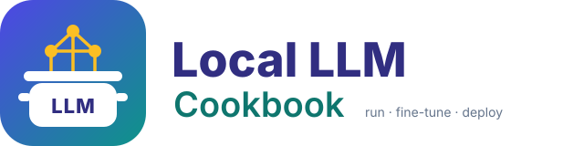

 

  

<h1 align="center">Local LLM Cookbook</h1>

  <strong>Learn to run, fine-tune, and deploy Large Language Models on your own hardware.</strong>

  An open-source, practical learning resource for local AI.

---

## Our Mission

Make local Large Language Models accessible to everyone.

We believe developers, students, researchers, and AI enthusiasts should be able to understand, run, and experiment with modern language models using their own hardware.

Local LLM Cookbook brings together practical knowledge, tutorials, tools, and reproducible examples to make local AI more accessible.

## Why This Project?

Getting started with local AI can be confusing.

Hardware requirements are often unclear, tutorials can become outdated, and the difference between running a model and fine-tuning one is not always explained properly.

This project aims to address those challenges through:

- Practical, step-by-step tutorials.
- Realistic hardware recommendations.
- Reproducible code examples and configurations.
- Clear explanations of local inference and fine-tuning.
- Open-source tools and community-driven knowledge.

## Who Is This For?

- **Beginners** learning about local AI and LLMs.
- **Developers** building applications powered by local models.
- **Students and researchers** exploring machine learning.
- **AI enthusiasts** experimenting with open-weight models.
- **Hardware-conscious users** exploring what their computers can realistically handle.

## What You'll Explore

| Area | Topics |
|---|---|
| Local inference | Running models with Ollama and LM Studio |
| Model selection | Choosing models based on hardware and use cases |
| Quantization | GGUF, GPTQ, AWQ, and memory optimization |
| Fine-tuning | LoRA, QLoRA, Unsloth, and LLaMA-Factory |
| Development | Building applications with local model inference |
| Deployment | Model conversion, GGUF export, and deployment workflows |

## Tools & Ecosystem

- [Ollama](https://ollama.com/) — Local model runtime.
- [LM Studio](https://lmstudio.ai/) — Desktop application for local inference.
- [Unsloth](https://unsloth.ai/) — Efficient model fine-tuning.
- [LLaMA-Factory](https://github.com/hiyouga/LLaMA-Factory) — Model fine-tuning framework.
- [Hugging Face](https://huggingface.co/) — Models, datasets, and machine learning ecosystem.
- [GGUF](https://github.com/ggml-org/ggml) — Model format used across local inference tools.

## Hardware Matters

Not every model runs on every computer.

Available RAM, GPU VRAM, processor, storage, quantization, and context length all influence performance.

This project prioritizes realistic hardware guidance and distinguishes between:

- **Inference:** Running an existing model.
- **Fine-tuning:** Adapting a model using additional training data.
- **Training from scratch:** Building a model through its initial training process.

A machine capable of running a quantized model is not necessarily capable of fine-tuning that model.

We aim to document practical limitations instead of making unrealistic hardware promises.

## Explore the Documentation

- [Getting Started](docs/getting-started.md)
- [Hardware Guide](docs/hardware-guide.md)
- [Model Selection](docs/model-selection.md)
- [Quantization Guide](docs/quantization.md)
- [Glossary](docs/glossary.md)
- [Troubleshooting](docs/troubleshooting.md)
- [Repository Structure](docs/repository-structure.md)

## Examples & Guides

Explore practical tutorials and code examples:

- `guides/` — Step-by-step tool and workflow tutorials.
- `examples/` — Practical inference, fine-tuning, and deployment examples.
- `configs/` — Reusable training configurations.
- `scripts/` — Setup and environment validation utilities.

## Contributing

Contributions are welcome!

Whether you're improving documentation, adding tutorials, testing models on your hardware, or contributing code, your help is valuable.

Read the [Contributing Guide](CONTRIBUTING.md) to get started.

## Project Roadmap

- [ ] Complete foundational documentation.
- [ ] Publish practical local inference tutorials.
- [ ] Document hardware-specific model recommendations.
- [ ] Add reproducible inference examples.
- [ ] Develop small-model fine-tuning examples.
- [ ] Document model conversion and deployment.
- [ ] Expand hardware compatibility and troubleshooting guidance.
- [ ] Welcome community contributions.

## License

See [LICENSE](LICENSE) for the project's licensing terms.

Models, datasets, libraries, and third-party tools referenced in this repository may have separate licenses and usage restrictions.